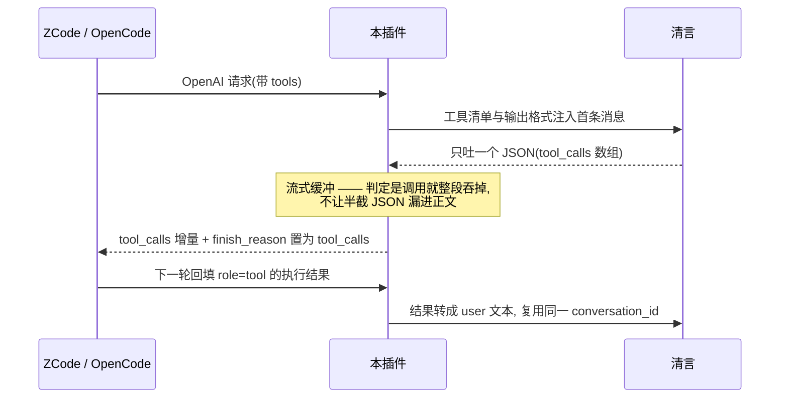

<p align="center">
  
</p>

把 **智谱清言 (chatglm.cn) 网页版** 接入 [magpie](https://usemagpie.ai) / OpenCode 的供应商插件。逆向网页端协议,让任意 OpenAI/Anthropic 客户端通过本地网关用上清言的 GLM 模型,并显示积分余额、自动领取每日登录积分。

> ℹ️ 工具调用: 清言网页协议**没有 function calling 字段**,插件用「提示词协议 + 出站解析」把它模拟出来(见下),因此 ZCode / OpenCode 这类编码 agent 也能用;但可靠性取决于模型是否守协议,复杂任务仍建议用官方 [GLM Coding Plan](https://github.com/magpie-community/plugins)(社区插件 `@magpie-community/opencode-zcode-auth`)。

## 快速开始

```bash
magpie plugin add github:TIUCSIB/magpie-zpqy-web   # 或本地: magpie plugin add ./magpie-zpqy-web
magpie plugin login chatglm                         # 选一种登录方式(见下)
magpie provider test chatglm                        # 最小请求验证
```

登录后即可通过本地网关调用 `chatglm/glm-5.3`、`chatglm/glm-5.3-flash`:

```bash
curl http://127.0.0.1:3425/v1/chat/completions \
  -H "authorization: Bearer magpie" -H "content-type: application/json" \
  -d '{"model":"chatglm/glm-5.3-flash","messages":[{"role":"user","content":"你好"}]}'
```

## 三种登录方式

<p align="center">
  
</p>

| 方式 | 体验 | 适合 |
|---|---|---|
| **浏览器授权**(推荐) | 插件自动拉起专属 Chrome/Edge 窗口,扫码登录后自动完成 | 真实账号积分 |
| **游客一键** | 零输入,秒登录 | 尝鲜(免费额度小) |
| **粘贴 Cookie** | F12 复制 `chatglm_token` 整串 | 无浏览器环境的兜底 |

浏览器授权的技术要点:Chrome 运行时 cookie 数据库被独占锁(实测连 `cp` 都读不动),且新版有 DPAPI/AES 加密——插件改为**自启一个带调试端口的专属 profile**,经 CDP `Storage.getCookies` 直接读浏览器内存,绕开文件锁与加密;判定登录成功的依据是 token JWT 里 `is_guest !== true`。不碰你日常浏览器的任何数据。

## 工作原理

插件的 `loader.fetch` 拦截 magpie 网关发出的 OpenAI Chat Completions 请求,翻译成清言协议,再把清言 SSE 流转回 OpenAI chunk:

| 项 | 值 |
|---|---|
| 对话端点 | `POST https://chatglm.cn/chatglm/backend-api/assistant/stream`(SSE) |
| 游客登录 | `POST /chatglm/user-api/guest/access` → token(约 2h;游客不可 refresh) |
| 真实登录 | 浏览器授权(CDP 读 cookie)或粘贴 cookie;`user/refresh` 自动续期 |
| 模型列表 | `GET /chatglm/agent-api/operation/detail?tag=available_models` |
| 积分用量 | `GET /chatglm/member-api/member/member_info`(`left_score` 以「分」计,÷100 显示) |
| 每日积分 | `POST /chatglm/member-api/member/daily_login_score`(usage 刷新时静默领取 +200) |
| **会话** | `conversation_id` 增量复用(实测完整历史内联会被忽略);首轮从响应提取新 conv id,历史断裂时回落为内联合并 |
| **工具调用** | 提示词协议模拟: 工具定义注入首条消息 → 出站解析成 OpenAI `tool_calls`(做法参考 [HelloGML](https://github.com/Hello-Application-XH/HelloGML)) |
| **签名** | `x-sign = md5("${x-timestamp}-${x-nonce}-<前端公开盐值>")` |
| 时间戳 | `Date.now()` 的 Luhn 校验位变换(倒数第 2 位 = 其余数字和 %10) |
| nonce | uuidv4 去横杠 |
| 必要头 | `app-name: chatglm`、`x-app-platform: pc`、`x-device-id`、`x-request-id`、`authorization: Bearer <token>` |
| SSE 语义 | `parts[].content[]` 的 `type: think\|text` 为增量,finish 事件重发该 part 全量;结束以 `status:"finish"` 为准,无 `[DONE]` |

**推理档位**:GLM-5.3 / GLM-Flash 各带三档 `low / high / max`(对应网页的 快速/深度/极致),声明为 magpie `variants`,在模型设置里勾选启用;请求时按 `reasoning_effort` 字段或模型 id 后缀(`chatglm/glm-5.3-flash:max`)映射到清言的 `chat_mode` + `reasoning_effort`。

## 工具调用

清言网页协议**没有接收外部工具定义的字段**(`messages` 只认 user / assistant 文本),所以插件用「提示词协议 + 出站解析」把它模拟出来 —— 这也是 [HelloGML](https://github.com/Hello-Application-XH/HelloGML) 等 2API 项目的通行做法:



具体做法:

| 环节 | 处理 |
|---|---|
| 工具清单 | 注入到首条消息的「工具调用协议」段(名字 / 描述 / 参数 schema) |
| 历史回放 | assistant 的 `tool_calls` 按同样 JSON 格式回放,让模型看到自己该用的格式 |
| 工具结果 | `role: "tool"` 转成 `# 工具执行结果 … 返回:` 的 user 文本(清言只认 user/assistant) |
| 流式防漏 | 正文以 `{` / `[` / 围栏 / `<tool_call` 开头时先进缓冲,确认是调用就整段吞掉,否则原样放行 |
| 解析 | 主认 `{"tool_calls":[…]}`;顺带兼容代码围栏、JS 对象字面量(裸键/单引号/尾逗号)、裸单个调用、GLM 原生的 `<tool_call>` 标签 |
| 多行参数 | 模型把代码直接写进参数时常常不转义换行(那段 JSON 严格来说是非法的),解析前会把字符串里的裸换行/制表符补成 `\n` / `\t` |
| 空转续写 | 这一轮既没有工具调用、正文又只是「…一次做完：」这类半句引导语时,自动带上「你刚才只说了半句」的提示再发一轮(每请求最多一次),避免 agent 循环停在冒号上 |
| 选型纪律 | 协议写明: 按工具描述选型(本地操作别抓网页类工具)、调用报错后禁止原样重发、调用只写正文 —— 针对实测出现过的「连错三次 open_url 烧光每轮 3 次上限、整轮报废」。两层落地: ①每轮工具结果都附带纪律提醒(首条消息里的协议会被长历史冲淡), 报错轮再加一段强化提醒; ②驱动层拦截 —— 历史里「结果像报错」的调用进黑名单, 模型原样重发时整轮换成点名续写轮(每请求一次, 续写后仍重发则放行, 由客户端每轮上限兜底) |
| 能力声明 | `tool_call: true`(config)/ `capabilities.toolcall: true`(provider)—— 否则客户端根本不会把工具发过来 |

**速度档位**:`低 / 高 / 最高` 对应清言的 快速 / 深度 / 极致(`chat_mode` + `reasoning_effort`)。客户端没选档位时按「低(快速)」发,想要更深的思考在模型设置里挑 `高` / `最高`(实测最慢能到 70s+ 才出正文)。

## OpenAI 兼容面

magpie/ZCode 看到的就是标准 Chat Completions 语义, 逐项对照:

| 能力 | 状态 | 说明 |
|---|---|---|
| 流式 / 非流式 | ✅ | 默认非流式(仅 `stream:true` 走 SSE, 与 OpenAI 一致); chunk 形状与 finish_reason(stop / tool_calls / length)与官方语义一致 |
| tools / tool_calls | ⚠️ 部分 | 提示词协议模拟。`none` 是驱动层硬保证(工具集清空+解析门控, 模型吐了调用 JSON 也不会输出 `tool_calls`); `auto`/指定函数可用(指定函数=协议里只留它); **`required` 属尽力而为**——注入强制文案但网页协议无原生保证, 模型仍回纯文本时按 `stop` 返回, 不伪造调用。出站只放行「名字在声明列表内 + arguments 合法 JSON + 参数过 schema」的调用; 参数解析失败的调用按普通文本处理, 不会变成空参数调用 |
| usage | ⚠️ 估算 | 清言不返回 token 数, 按 CJK 1 字≈1 token、其余 4 字符≈1 token 估; prompt 按客户端完整上下文计账, 思考单独计入 reasoning_tokens; 流式 usage 尾块仅当请求带 `stream_options.include_usage:true` 时输出, 且排在 `[DONE]` 之前 |
| reasoning_content | ⚠️ 仅流式 | 思考增量透传成 `delta.reasoning_content`(扩展字段, 非 OpenAI 标准); **非流式响应不含思考内容**——聚合路径无此字段, 需要看思考过程请用 `stream:true` |
| 采样参数 | ❌ 收下忽略 | temperature / top_p / seed / max_tokens 网页版不暴露, 不生效(模型能力声明 `temperature:false` 与此一致, 客户端设置不会有效果) |

### 回合终态与错误语义

一轮对话有且只有一个权威终态(`ROUND.*`),`end()` 时一次性判定、之后不再改,不再靠布尔组合猜。**只有 `completed` 算成功**:

| 终态 | 触发 | 非流式 | 流式(已开始) |
|---|---|---|---|
| `completed` | 事件级 `status:finish` | `chat.completion`(stop / tool_calls / length) | chunk + finish_reason + `[DONE]` |
| `upstream_error` | `status:error` / `status:intervene` / `last_error` | HTTP 502 + OpenAI 错误体 | 流内 `{error}` 帧 + 关闭,**不发 `[DONE]`** |
| `interrupted` | `reader.read()` 抛异常 | 502 + 错误体(code `stream_interrupted`) | 流内 error 帧,不发 `[DONE]` |
| `incomplete` | EOF 但没收到完成帧 | 502 + 错误体(code `stream_incomplete`) | 流内 error 帧,不发 `[DONE]` |
| `truncated` | 输出超上限主动掐断 | `finish_reason:length` | chunk… + length + `[DONE]` |
| `cancelled` | 调用方 abort / 下游断开 | 499(code `cancelled`) | 流关闭,不发 `[DONE]`、不提交会话 |

要点:
- **错误不会被伪装成成功**:上游 `error`/`intervene`、读流异常、没有完成帧的 EOF,既不返回 `chat.completion`,也不发代表正常结束的 `[DONE]`;这些情况下**不会**返回 `tool_calls`(哪怕正文里有半截 JSON)。
- **会话前缀只在 `completed` 时提交**:失败/中断/取消/截断都不记 `conversation_id → 已发前缀`,下一条请求会保守地重开会话,而不是把半截上下文当成功复用。
- **取消即终止**:abort 后延迟重试、空转续写全部停,上游 fetch/reader/心跳定时器随之释放;已产生部分输出后**不会**重放整轮。
- **区分三个 finish**:清言**事件级** `status:finish`(回合完成) ≠ part 的 `status:finish`(该 part 全量快照) ≠ 下游 OpenAI 的 `[DONE]`(流结束标记)。只有第一个算上游正常完成。

> ⚠️ 流内错误的已知兼容限制:HTTP 200 的 SSE 一旦开始就无法再改状态码,插件采用「流内 `data:{error}` + 直接关闭、不发 `[DONE]`」的策略(与 OpenAI 官方流式错误同形)。绝大多数 OpenAI 兼容客户端能识别;只做「见到 `[DONE]` 才算成功、否则当断线重连」的字面型客户端可能把这次断开当异常结束而非明确报错 —— 但它至少**不会**被误导成「回答成功完成」。`npm run test:live` 用真实清言验证正常路径,错误路径由 `test-terminal.mjs` 用 mock 流确定性覆盖。

### 会话隔离与交付状态(0.4.1)

清言的多轮上下文存在服务端 `conversation_id` 里,插件要决定「这条 conv 能不能复用、发了哪些消息」。0.4.1 起,复用判定从「仅内容前缀」升级为六条件门控(设计文档 `docs/phase2-session-design.md`):

| 条件 | 作用 |
|---|---|
| 账号摘要一致 | 换登录账号后旧 conv 不再被匹配(防跨账号串会话) |
| 上下文指纹一致 | 系统提示 / 工具清单 / schema / 模型 / 档位任一变化 → 重开(防旧指令残留) |
| 宿主会话标识一致 | magpie/OpenCode 的 `sessionID` 经 `chat.headers` 注入(读回即删、不发清言),两个 Agent 任务同前缀也不串用 |
| 历史前缀成立 | 已发送回合必须是本次历史的前缀;客户端压缩/裁剪 → 退役重建,绝不 slice 跳过 |
| 未被隔离/退役 | 交付不确定的会话(断流/上游报错/截断)冻结复用,恢复一律全史内联新建 |
| 无在途请求 | 同一 conv 并发到达时,第二条拒绝复用走重建(不排队、不互相阻塞) |

关键不变量:**不确定交付时隔离的是「请求开始时选定的那条 conv」**(快照,与响应是否回 id 无关);隔离是单向棘轮——迟到的成功响应不会复活它,其他请求的完成也不会解除它。增量还受消息数(≤64)、体积(≤512KB)、耗时(≤30 分钟)三重保护,防止把陈旧或异常大的映射当可信续点。

> ⚠️ 无会话头的已知极限:宿主不转发 `chat.headers`(如某些直连 OpenAI 客户端)时,插件只能靠「内容前缀 + 账号 + 上下文指纹」匹配。**两个独立任务若用户消息前缀相同,无法彻底区分**——这是降级路径的固有极限,只能靠隔离/在途/多候选重建收窄,不能根除。需要强隔离请在 magpie/OpenCode 内使用(实测其 `sessionID` 稳定可用)。


## 已知限制

- **工具调用是模拟的**: 可靠性取决于模型守不守协议。实测 GLM-5.3 / GLM-Flash 在 agent 循环里能稳定给出调用,但参数很复杂或描述含糊时仍可能解析失败;模型偶尔会把自己的调用"演"成文本。
- **引导语空转**: 模型有时只写一句「继续,三处编辑一次做完:」就结束这一轮,既不给调用也不给结论。插件会判定为空转并自动续写一轮(注入 `TOOL_NUDGE` 提示),仍不奏效时这一轮就只剩那句引导语 —— 再点一次「继续」通常就好了。已出错误终态(上游 error/断流/取消)的回合**不会**触发续写,防止把半截输出重放成双份。
- **模型退化时会狂吐**: 实测出现过一次输出原地打转(上万帧、五十多万字)后上游直接报 `status: error`。插件会在 30 万字处截断,按 OpenAI 截断语义报 `finish_reason: length`(非流式 200 + length;流式 chunk + length + `[DONE]`),不会伪装成自然完成,该轮会话前缀也不提交。
- **会话映射是进程内内存态**: LRU 48 条,隔离/退役记录 24h 过期删除;magpie 重启或淘汰后历史由「内联兜底」重放一次(质量略降但可用,不会串上下文)。门控与隔离机制见上节「会话隔离与交付状态」。
- **专属 profile 每次都要登录**: 浏览器授权用的是插件自己的干净 profile,不共享你日常浏览器的登录态——这是安全设计。
- **风控**: 请求过密会被清言返回滑块 HTML,usage 卡片会显示"风控限流中";建议保持 `maxConcurrency ≤ 2`。
- **附件/图像上传没接**: 图片消息的 `image_url` 会被忽略(声明里 `attachment: false`),HelloGML 那套文件上传还没搬过来。
- **协议会变**: 网页接口无稳定性承诺,盐值是前端硬编码;清言改版需重新抓包(方法见下)。
- **无签到按钮**: magpie 没有给社区插件渲染操作按钮的钩子,每日积分改为 usage 刷新时静默领取。

## 重新抓包 / 调试

1. Chrome 开 `chatglm.cn` → F12 Network → 发消息 → 找 `assistant/stream`。
2. 对照上表核对端点/头/请求体/SSE。
3. 签名函数在页面 `main.*.js` 里(搜 `x-nonce`),等价实现已在 `_internal.luhnStamp`。
4. 改版导致盐值变更: 设 `CHATGLM_SIGN_SALT=<新盐>` 即可续命, 不必等插件发版。
5. 设 `CHATGLM_DEBUG=1` 把请求摘要与上游原始 SSE 帧样本打进 magpie 日志, 便于对照抓包定位协议漂移。

## 测试

```bash
npm test              # 纯逻辑, 不联网: 工具调用解析/流式组装/会话复用 + 终态回归(mock fetch/SSE) + 登录流程判定
npm run test:live     # 联网冒烟(用本机 magpie 已登录的账号, 会消耗少量积分)
```

`test-terminal.mjs` 用 mock 的 `fetch`/`Response`/`ReadableStream` 确定性复现全部失败场景(上游 error/intervene、读流异常、无完成帧 EOF、半截断流、错误态工具 JSON、取消不重试、stream 三态、usage 门控、会话只在成功时提交),每次 `npm test` 都跑,不消耗积分。

`test-session.mjs` 覆盖会话隔离(0.4.1): 六条件匹配门控、acct/ctxKey 摘要、前缀不成立退役、增量三重保护、交付快照隔离、隔离棘轮、并发多候选重建、清理与 LRU 顺序,同样全 mock 不联网。

`npm run test:live` 会走一遍: 带工具的请求 → 应回 `tool_calls`(不能漏 JSON 到正文)→ 回填工具结果 → 应复用会话并给出最终回答 → 普通对话回归。

```bash
# 端到端冒烟(游客身份, 需联网)
magpie provider test chatglm
```

## 发布

- npm: `npm publish`(建议加 scope 防重名),keywords 已含 `opencode auth plugin provider` 便于检索。
- 社区收录: 向 [magpie-community/plugins](https://github.com/magpie-community/plugins) 的 `registry.json` 提 PR。
- GitHub topic: 本仓库已可加 `magpie-plugin` 标签进入"非官方插件"页。

## 合规提示

本插件逆向的是清言**公开网页端**协议,用于个人自动化;请遵守智谱服务条款,勿用于转售 API 或高频滥用。

## License

[MIT](./LICENSE)
